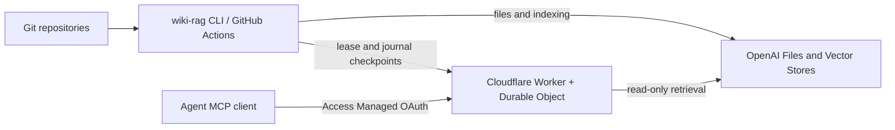

# Deploy wiki4llm

This guide deploys the OpenAI-backed stack: the `wiki-rag` CLI runs locally or in
GitHub Actions; the MCP gate runs on Cloudflare. The CLI is not a persistent server.
The optional native Node/QMD deployment is covered separately in
[gate containers](../gate/docs/containers.md).



| Component      | Runs where                                   | Persistent data                                   |
| -------------- | -------------------------------------------- | ------------------------------------------------- |
| `wiki-rag`     | Operator machine or ephemeral Actions runner | None in remote mode                               |
| `gate/` Worker | Your Cloudflare account                      | Grants, journal and active manifests in SQLite DO |
| Retrieval      | Your OpenAI API project                      | Uploaded files and vector-store index             |
| Source/config  | Your Git repositories                        | Committed documents and nonsecret configuration   |

State is saved by the CLI through the gate API. No bot commits state to Git, and
GitHub cache/artifacts are not the state authority. No GPU or persistent VM is
required for this OpenAI-backed setup.

## 1. Install the operator tools

Use Python 3.14, uv, Node 24 or newer, npm and Git on macOS or Linux:

```sh
git clone https://github.com/rotnov/wiki4llm.git
cd wiki4llm
uv sync --frozen
npm ci --prefix gate
uv run wiki-rag --help
```

Choose and record a reviewed Git commit for deployment and workflow consumption.
The Python package/command remains `wiki-rag`; `wiki4llm` is the repository name.
Run the [local verification](development.md) before deploying a changed version.

## 2. Create the OpenAI resources

Choose an API project and record its `proj_...` identifier. Create separate project
credentials for ingestion and retrieval. Project service accounts are appropriate
for automation; organizational administration credentials are not runtime keys.
See [OpenAI identities and keys](https://developers.openai.com/api/docs/guides/api-keys).

| Credential                                         | Used by       | Required operations                                             |
| -------------------------------------------------- | ------------- | --------------------------------------------------------------- |
| Ingestion key                                      | CLI/GHA       | Create/read/delete Files; attach/poll/remove vector-store files |
| Query key                                          | Worker secret | Vector-store search and parsed-content reads                    |
| Organization admin key, if using provisioning APIs | Operator only | Project/service-account administration                          |

Provision one **fresh empty vector store per collection**, in that same project.
The store-create API is [documented by OpenAI](https://developers.openai.com/api/reference/resources/vector_stores/methods/create).
For example, once your secret manager supplies `WIKI_RAG_INGEST_KEY` and you set
the nonsecret `OPENAI_PROJECT_ID` in the process environment (export it from your
shell), run this once for one collection:

```sh
uv run python - <<'PY'
import os
import httpx

with httpx.Client(timeout=30, follow_redirects=False, trust_env=False) as client:
    response = client.post(
        "https://api.openai.com/v1/vector_stores",
        headers={
            "Authorization": "Bearer " + os.environ["WIKI_RAG_INGEST_KEY"],
            "OpenAI-Project": os.environ["OPENAI_PROJECT_ID"],
        },
        json={"name": "team-docs-guide"},
    )
    response.raise_for_status()
    print(response.json()["id"])
PY
```

Keep the returned `vs_...` ID. If creation has an unknown outcome, reconcile the
existing resources before creating another store. Decide retention explicitly;
an expiring test store is not a permanent production index.

Do not reuse stores containing an unrelated or legacy index. The current authority
binds project, collections, repository/branch identities and stores immutably.
Choose all workspace collections before provisioning. Use a separate pilot
workspace if you intend to change that topology during experimentation.

## 3. Deploy and bootstrap the gate

Follow the complete [Cloudflare deployment recipe](../gate/docs/deployment.md).
It covers the hostname, Access application, Managed OAuth, Worker configuration,
query secret, immediate Durable Object activation and temporary operator access.

Prepare private working copies of [the deployment examples](../examples/deployment):

- `ingestion.json`: project, stores and every collection's repository/branch binding.
- `publisher.json`: the verified Access service identity allowed to ingest this workspace.
- `reader.json` and `identity.json`: reader grants and the verified human Access subject.
- `wiki-rag.toml`: the matching producer configuration.

Replace every example project/store/repository/identity value before applying it.
`team-docs` and `guide` are sample workspace/collection names, not pre-created
resources. `credentialEnv` names the Worker's query secret, never its value.
The gate recipe provides the exact administrative commands for these files.

## 4. Configure the source and preview

Put the adapted TOML in the source/config repository. The project and collection
bindings must exactly match provisioning. Start with a small explicit Markdown
allowlist; extend it only after reviewing the selection. See
[selection semantics](../README.md#configuration-and-selection).

For local runs, `root` is relative to the TOML file. Check out each configured
branch with full history. Selected content and the Git index must match HEAD;
remote mode refuses dirty, shallow or stale sources. Do not let Git transform
selected bytes through LFS, encoding or EOL filters. The shared GHA runner prepares
its own literal source checkouts and replaces roots in memory.

Provide these variables through a secret manager or the runner environment:

| Variable                        | Value                                                |
| ------------------------------- | ---------------------------------------------------- |
| `WIKI_RAG_GATE_ORIGIN`          | Nonsecret origin, such as `https://gate.example.com` |
| `WIKI_RAG_ACCESS_CLIENT_ID`     | Publisher Access client ID                           |
| `WIKI_RAG_ACCESS_CLIENT_SECRET` | Matching publisher secret                            |
| `WIKI_RAG_INGEST_KEY`           | Project ingestion key; needed only when applying     |

Then, from the tool checkout, with an absolute path to your adapted configuration:

```sh
uv run wiki-rag --config "$RAG_CONFIG" status
uv run wiki-rag --config "$RAG_CONFIG" plan
```

Set the nonsecret `RAG_CONFIG` path first. Before initial indexing, expect
`initialized: false`. A plan makes source reads and read-only gate requests; it
does not upload files or need an OpenAI key. Verify every selected path and count.

## 5. Index, repeat, and verify MCP

```sh
uv run wiki-rag --config "$RAG_CONFIG" index --apply
uv run wiki-rag --config "$RAG_CONFIG" index --apply
uv run wiki-rag --config "$RAG_CONFIG" status
```

The first run initializes the empty authority and publishes. The second run, using
the same source commits, selected bytes and processing configuration, must preserve
publication/file identity and create no replacement operations. A new repository
commit can change publication metadata even if all selected file IDs are reused.
`index --apply` is safe for initial and subsequent convergence; `update --apply`
requires an already initialized authority.

Connect your MCP client to `https://gate.example.com/mcp` and complete Access OAuth.
The authenticated identity must also have a gate reader mapping. Verify the six
tools (`list_workspaces`, `query`, `find_documents`, `get`, `multi_get`, `status`), query a known phrase,
and use `get` on its returned reference. Check repository/path provenance and deny
access to a workspace outside that reader's grants. Login alone is not retrieval
acceptance. Human reader OAuth does not grant ingestion or administration.

For an incremental test, commit one document change and apply again. Verify only
its file ID changes and unchanged documents remain accessible. Use a disposable
pilot corpus for rename/deletion tests; inspect the old/new active manifests.
Keep nonsecret receipts and resource IDs outside the public tool repository.

## 6. Connect GitHub Actions

Install [the caller template](../examples/github-actions/call-ingest.yml) in the
consumer repository's `.github/workflows/`. Pin both its workflow `uses` and
`tool-ref` to the same reviewed commit for reproducible runs, or follow `main`
for both to automatically consume upstream updates. The latter trusts future tool
changes with the supplied credentials.

The template is manual-only, with `mode` defaulting to `plan`; it does not enable
automatic indexing when copied. After manual acceptance and authorization, add a
push trigger for the actual default branch. Its existing mode expression then
selects `sync` for pushes while preserving manual plan/sync selection.

The [GHA guide](github-actions.md) owns the complete input/secret/output contract.
Pass `workspace`, `project-id`, `collections` and `gate-origin` (or `config`
and `gate-origin` for a committed TOML); map `gate-client-id`, `gate-token` and `openai-key`
from GitHub Secrets. `github-token` is optional: the built-in token covers the
caller repository and accessible public sources; other private repositories need
a contents-read credential. Protect the selected publisher environment and limit
the service identity to the intended workspace.

Start with `mode: plan` on a trusted default-branch manual run. Confirm the Actions
logs, source selection and gate authentication, then switch to `mode: sync` for
approved pushes/manual runs. Automatic ingestion rejects non-default-branch pushes and PR contexts. Manual
branch dispatch requires the selected environment to permit that branch. Every invocation updates the whole configured workspace. The DO lease
coordinates callers; GitHub concurrency alone does not span repositories.

## Upgrades and recovery

Keep Worker name, DO namespace, issuer/audience, query-secret names and workspace
bindings stable during ordinary upgrades. Follow the gate recipe for explicit
secret inheritance and immediate operator-configuration activation. Pausing
publishers before deployment prevents an intentional reset from interrupting them.

For pinned consumers, update workflow/tool pins together, run plan, then perform
the no-op/MCP checks. Consumers following `main` pick up upstream updates automatically.
Restoring older application code does not roll back journal or OpenAI state. Do
not copy a stale local journal into the remote authority or delete its state to
"fix" an indexing error. See [remote recovery](remote-state.md#failure-and-concurrency-behavior).

| Symptom                                          | Check                                                              |
| ------------------------------------------------ | ------------------------------------------------------------------ |
| OAuth succeeds, but no workspaces are visible    | Gate reader principal and identity mapping; first publication      |
| Publisher receives 403                           | Access service policy, exact service identity and publisher grant  |
| Newly configured operator receives 403           | Immediate activation and authenticated `/admin/status` readiness   |
| Gate returns 503 after an Access change          | Issuer/audience no longer match the existing authority             |
| Initial index refuses stores                     | Use empty stores with a fresh authority; do not adopt legacy data  |
| Lease timeout or stale source                    | Fresh checkout/rerun; never restore cached state to force progress |
| Publication committed but cleanup failed         | Keep state; reconcile with a fresh attempt                         |
| An unknown/obsolete operation remains unresolved | Preserve its intent; investigate, do not blindly re-upload         |

Already-dispatched provider calls cannot be cancelled by the lease. The documented
`upload_ready` maintenance limitation and journal quota still apply. Back up and
recover DO state together with operator policy/bindings; a backup/restore drill is
an operator acceptance task, not a consequence of a successful deploy command.

## Invite readers

After deployment, follow the [invitation guide](../gate/docs/invitations.md) to
create email-bound links and verify browser activation and MCP access.
